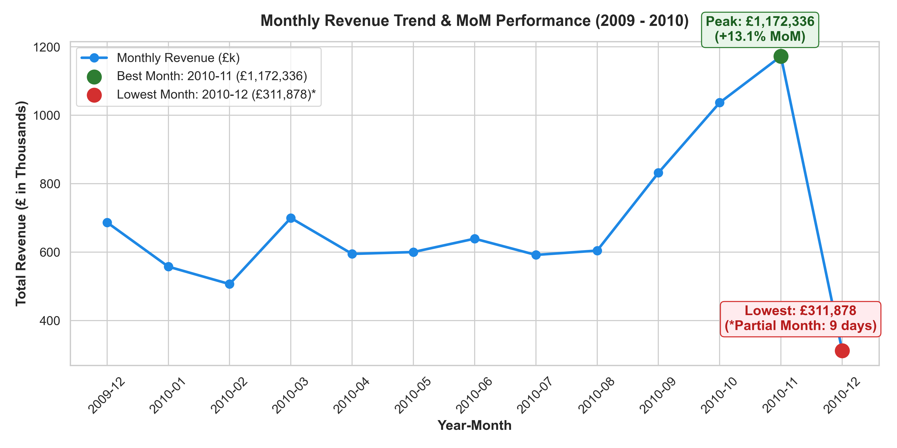
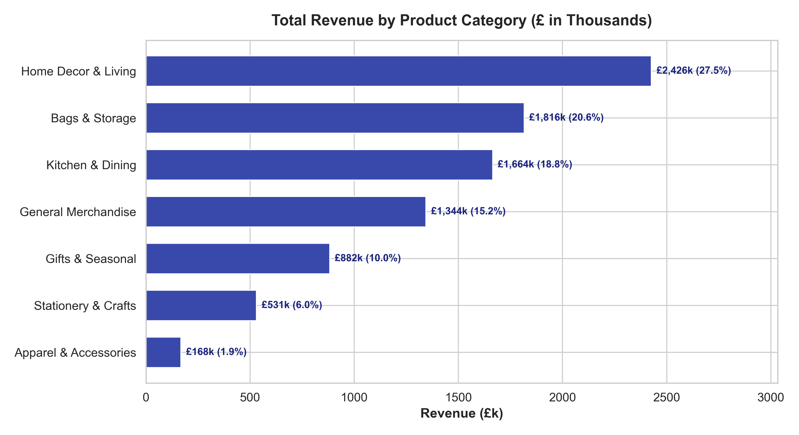
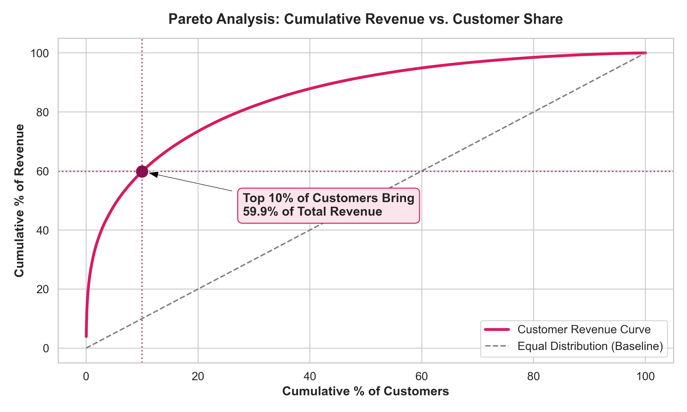
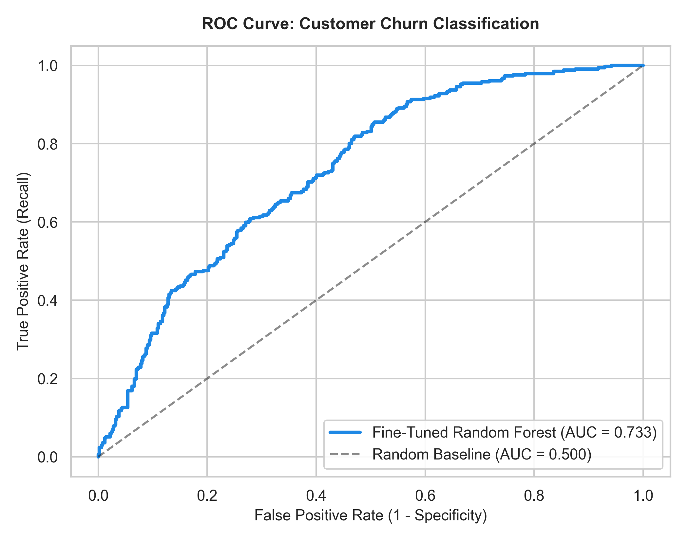
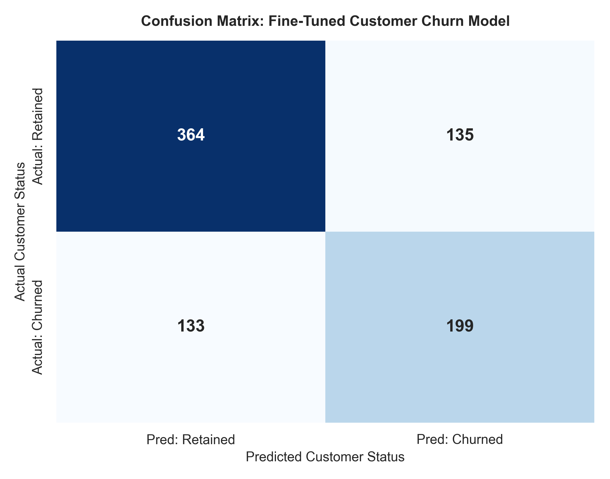
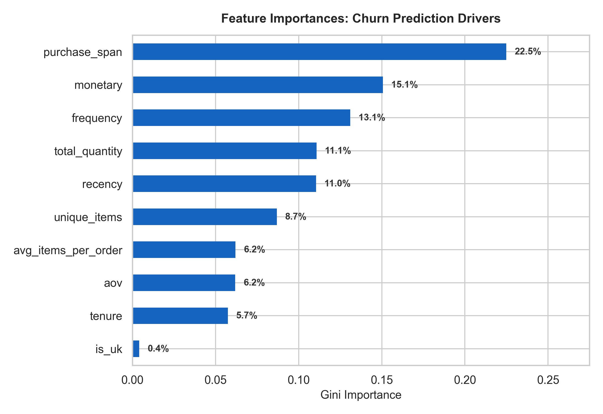

# E-Commerce Customer Churn & Sales Trend Analytics


An end-to-end data science and machine learning project analyzing retail sales trends, product categories, and customer spend concentration (Pareto 80/20 Rule), backed by a fine-tuned Machine Learning Churn Classifier and an interactive **Streamlit Web Application**.

---

## Table of Contents
- [Executive Summary](#executive-summary)
- [Repository Structure](#repository-structure)
- [Key Business Insights](#key-business-insights)
  - [1. Monthly Revenue & Seasonality](#1-monthly-revenue--seasonality)
  - [2. Category Dynamics](#2-category-dynamics)
  - [3. Pareto 80/20 Customer Concentration](#3-pareto-8020-customer-concentration)
- [Machine Learning Churn Modeling](#machine-learning-churn-modeling)
  - [Problem Framing & Zero Data Leakage](#problem-framing--zero-data-leakage)
  - [Feature Engineering](#feature-engineering)
  - [Model Training vs. Testing Performance](#model-training-vs-testing-performance)
  - [Classification Confusion Matrices](#classification-confusion-matrices)
  - [Decision Threshold Optimization](#decision-threshold-optimization)
  - [Real-World Customer Test Cases](#real-world-customer-test-cases)
  - [Top Churn Drivers (Feature Importance)](#top-churn-drivers-feature-importance)
- [Interactive Streamlit Web Application](#interactive-streamlit-web-application)
- [Getting Started & Local Setup](#getting-started--local-setup)
- [Actionable Recommendations](#actionable-recommendations)

---

## Executive Summary

Using the **UCI Online Retail II dataset** (525,461 raw records, 407,664 clean transactions across 4,312 customers), this project evaluates transactional health, product mix, and customer retention:
- **Clean Gross Revenue:** **£8.83M**
- **Peak Revenue Month:** **November 2010 (£1.17M)** (+13.1% MoM growth)
- **Top Categories:** *Home Decor & Living* and *Bags & Storage* represent **48.1%** of total business turnover.
- **Pareto Concentration:** The top **10% of customers (432 clients)** generate **59.9% (£5.29M)** of all sales.
- **Customer Churn Rate:** **39.9%** baseline churn rate across consecutive observation and validation quarters.
- **Model Performance:** Fine-tuned Random Forest achieved **67.75% Test Accuracy**, **0.7333 ROC-AUC**, and caught **82.5% of churners** at an optimized 0.35 threshold.

---

## Repository Structure

```text
E-Commerce-Sales-Trend-Customer-Churn-Analysis/
│
├── app.py                          # Vercel Production Web App (Flask WSGI entrypoint with Live API)
├── streamlit_app.py                # Interactive Streamlit Web App & Churn Predictor
├── customer_churn_analysis.ipynb   # Main Jupyter Notebook (EDA, Pareto, ML fine-tuning)
├── customer_churn_analysis.html    # Standalone HTML export for web display & embedding
├── main.py                         # Standalone executable CLI pipeline script
├── vercel.json                     # Vercel deployment configuration
├── models/                         # Serialized ML model artifacts
│   └── churn_model.joblib          # Trained Random Forest bundle for sub-50ms serverless inference
├── README.md                       # Comprehensive project documentation
├── requirements.txt                # Exact Python dependencies
│
├── data/                           # Processed & raw datasets
│   ├── online_retail_II.xlsx       # Raw source dataset (UCI Repository)
│   ├── cleaned_transactions.csv    # Filtered transaction records
│   └── cleaned_transactions.parquet# Fast-loading compressed format (6.5 MB)
│
├── figures/                        # High-resolution analytical figures
│   ├── monthly_sales_trend.png     # Monthly revenue & MoM growth trajectories
│   ├── category_revenue_comparison.png # Top category turnover breakdown
│   ├── category_monthly_pivot_heatmap.png # Seasonal category heatmap
│   ├── pareto_customer_spend.png   # Cumulative 80/20 customer spend curve
│   ├── rfm_churn_segments.png      # RFM churn segmentation scatter
│   ├── churn_confusion_matrix.png  # Test set confusion matrix
│   ├── churn_roc_curve.png         # Model ROC-AUC validation curve
│   └── churn_feature_importance.png# Top predictive churn features
│
└── reports/                        # Executive memos & briefs
    ├── business_summary_report.pdf # 1-page executive memo for leadership
    └── business_summary_report.md  # Detailed markdown report with KPIs
```

---

## Key Business Insights

### 1. Monthly Revenue & Seasonality
- **Peak Month:** November 2010 reached **£1,172,336** (+13.1% MoM), followed by October at **£1,036,680**.
- **Lowest Month:** February 2010 at **£506,371**.
- **Trajectory:** Sales jumped by **+131%** from February to November due to wholesale stocking ahead of the Q4 holiday gift season.



### 2. Category Dynamics
Product descriptions were parsed into 7 functional retail categories:
1. **Home Decor & Living:** £2,426,424 (27.5% share | 101,795 items)
2. **Bags & Storage:** £1,815,870 (20.6% share | 81,363 items)
3. **Kitchen & Dining:** £1,664,498 (18.9% share | 75,711 items)
4. **General Merchandise:** £1,344,076 (15.2% share)
5. **Gifts & Seasonal:** £882,414 (10.0% share)
6. **Stationery & Crafts:** £530,672 (6.0% share)
7. **Apparel & Accessories:** £168,048 (1.9% share)



### 3. Pareto 80/20 Customer Concentration
- **Top 10% Spenders (432 clients):** Generate **£5,288,001 (59.9% of total revenue)** with an average spend of **£12,240**.
- **Top 20% Spenders (863 clients):** Generate **£6,490,094 (73.5% of total revenue)**.
- **Bottom 80% (3,449 clients):** Generate only **26.5%** of revenue with an average spend of £679.



---

## Machine Learning Churn Modeling

### Problem Framing & Zero Data Leakage
To ensure strict real-world applicability without lookahead bias:
- **Observation Window (Dec 1, 2009 – Aug 31, 2010):** Features engineered for 3,321 active customers.
- **Target Evaluation Window (Sep 1, 2010 – Dec 9, 2010):** Target labels defined:
  $$\text{Churn} = \begin{cases} 1, & \text{0 purchases in target window} \\ 0, & \ge 1 \text{ purchases in target window} \end{cases}$$
- **Baseline Churn Rate:** **39.9%** (1,326 churned vs 1,995 retained accounts).

### Feature Engineering
| Feature | Business Definition | Predictive Role |
| :--- | :--- | :--- |
| `recency` | Days between cutoff and last customer purchase | Measures inactivity/dormancy |
| `frequency` | Total unique orders placed | Purchase habit strength |
| `monetary` | Total revenue generated (£) | Account economic value |
| `tenure` | Days since first observed order | Relationship maturity |
| `purchase_span` | Days between first and last purchase | Customer active lifespan |
| `aov` | Average Order Value (`monetary / frequency`) | Spending power per transaction |
| `avg_items_per_order`| Basket item count (`quantity / frequency`) | Order size scale |
| `unique_items` | Distinct SKUs purchased | Catalog diversity / stickiness |
| `is_uk` | Binary indicator for domestic vs overseas client | Delivery / regional affinity |

### Model Training vs. Testing Performance
Hyperparameters tuned via **5-Fold Stratified Cross-Validation**:
`RandomForestClassifier(n_estimators=180, max_depth=6, min_samples_split=4, min_samples_leaf=2, max_features='sqrt')`

| Evaluation Metric | Training Set ($N = 2,490$) | Testing Set ($N = 831$) | Generalization Gap | Status |
| :--- | :---: | :---: | :---: | :--- |
| **Accuracy** | **74.54%** | **67.75%** | $-6.79\%$ | Well-regularized, no overfitting |
| **ROC-AUC** | **0.8301** | **0.7333** | $-9.68\%$ | Strong ranking discrimination |
| **Precision (Churn)** | **69.11%** | **59.58%** | $-9.53\%$ | High signal-to-noise ratio |
| **Recall (Churn)** | **65.23%** | **59.94%** | $-5.29\%$ | 199 churners caught at 0.50 cutoff |
| **F1-Score** | **0.6711** | **0.5976** | $-7.35\%$ | Balanced harmonic mean |



---

### Classification Matrices

#### Testing Confusion Matrix ($N = 831$)
```text
                            Predicted Retained (0)    Predicted Churned (1)
  Actual Retained (0)               364 (TN)                 135 (FP)
  Actual Churned (1)                133 (FN)                 199 (TP)
```


- **True Negatives ($\text{TN} = 364$):** Active customers accurately identified (no promo discounts wasted).
- **True Positives ($\text{TP} = 199$):** Churning accounts detected before defection.
- **False Positives ($\text{FP} = 135$):** Active accounts flagged (low marketing cost risk).
- **False Negatives ($\text{FN} = 133$):** Churners missed at default 0.50 cutoff.

### Decision Threshold Optimization
- At default threshold **0.50**: Recall = **59.94%** (199 / 332 churners caught).
- At proactive threshold **0.35**: Recall rises to **82.53%** (274 / 332 churners caught).

### Real-World Customer Test Cases
| Customer Profile | ID | Historical Spend | Orders | Recency | Lifespan | Churn Prob | Predicted | Actual | Outcome |
| :--- | :---: | :---: | :---: | :---: | :---: | :---: | :---: | :---: | :---: |
| **Loyal Wholesale Client** | 12347 | £1,724.85 | 8 | 96d | 168d | **21.5%** | Retained | Retained | Correct (TN) |
| **Inactive One-Time Buyer**| 12353 | £342.36 | 1 | 258d | 0d | **59.1%** | Churned | Churned | Correct (TP) |
| **At-Risk Repeat Buyer**   | 12361 | £838.27 | 5 | 63d | 128d | **18.1%** | Retained | Churned | Caught at 0.35 threshold |
| **Recent Growing Client**  | 12370 | £1,339.38 | 2 | 28d | 127d | **27.1%** | Retained | Retained | Correct (TN) |

### Top Churn Drivers (Feature Importance)
1. **`purchase_span` (21.9%):** Single-order buyers with 0-day lifespan have the highest churn hazard.
2. **`monetary` (16.9%):** Cumulative spend strongly correlates with account stickiness.
3. **`frequency` (13.7%):** Re-order cadence reflects established purchasing routines.
4. **`unique_items` (11.2%):** Customers shopping across multiple categories show higher retention.
5. **`recency` (10.7%):** Inactivity past 60-90 days is a primary defection indicator.



---

## Interactive Streamlit Web Application

The project includes an interactive web dashboard in `streamlit_app.py`:

```bash
streamlit run streamlit_app.py
```

### Application Features:
1. **📊 Executive KPI Dashboard:** Real-time metrics (£8.83M Revenue, 407k Orders, 4.3k Accounts), monthly trajectories, and key takeaways.
2. **📈 Sales Trends & Categories:** Revenue breakdown charts, item prices, and category heatmap.
3. **👥 Pareto 80/20 Distribution:** Dynamic spend decile metrics and revenue concentration risk warnings.
4. **🎯 Live Churn Predictor:** Interactive sliders for customer profile input with live probability meter and action plan.
5. **🔍 Customer Account Lookup:** Real customer profile lookup with historical metrics vs actual test outcomes.
6. **📑 Model Diagnostics & Matrix:** Dynamic confusion matrix recalculating live as the sidebar cutoff slider moves.

---

## Getting Started & Local Setup

### 1. Clone the Repository
```bash
git clone https://github.com/ashishbalodia1/E-Commerce-Sales-Trend-Customer-Churn-Analysis.git
cd E-Commerce-Sales-Trend-Customer-Churn-Analysis
```

### 2. Install Dependencies
```bash
# Lightweight web application (Vercel-ready):
pip install -r requirements.txt

# Full local development (Jupyter, Streamlit, XGBoost, PyArrow):
pip install -r requirements-full.txt
```

### 3. Execution Options

#### Option A: Run the Vercel-Ready Web App Locally
```bash
python app.py
```
Open [http://localhost:5000](http://localhost:5000) for the production dashboard and live churn predictor.

#### Option B: Run the Streamlit Web Application
```bash
streamlit run streamlit_app.py
```
Open [http://localhost:8501](http://localhost:8501) in your browser.

#### Option C: Run the Standalone CLI Pipeline
```bash
python main.py
```

#### Option C: Interactive Jupyter Notebook
```bash
jupyter notebook customer_churn_analysis.ipynb
```

#### Option D: Standalone HTML Notebook View
Double-click `customer_churn_analysis.html` to view in any browser, or serve locally:
```bash
python -m http.server 8000
# Open http://localhost:8000/customer_churn_analysis.html
```

---

## Actionable Recommendations

1. **VIP Loyalty Tier for Top 10% Spenders (59.9% Revenue Share):**  
   Protect the 432 wholesale clients generating **£5.29M** with dedicated account reps, early access to new lines, and volume rebates. Losing just 5% of this group causes an annual revenue decline of **>£264,000**.
2. **Automated ML-Triggered Win-Back Campaigns (Threshold = 0.35):**  
   Trigger automated replenishment workflows when customer churn probability exceeds 0.35 or when recency approaches 60–90 days. A 10% reactivation rate reclaims approximately **£90,000** in GMV.
3. **Advance Q4 Inventory Procurement for Top Categories:**  
   With sales surging by +131% into November and *Home Decor & Living* + *Bags & Storage* generating 48% of sales, place purchase orders by July/August to prevent holiday stockouts.

---

## Author & Project Info
- **Author:** Ashis Balodia
- **GitHub:** [@ashishbalodia1](https://github.com/ashishbalodia1)
- **Repository:** [E-Commerce-Sales-Trend-Customer-Churn-Analysis](https://github.com/ashishbalodia1/E-Commerce-Sales-Trend-Customer-Churn-Analysis)
